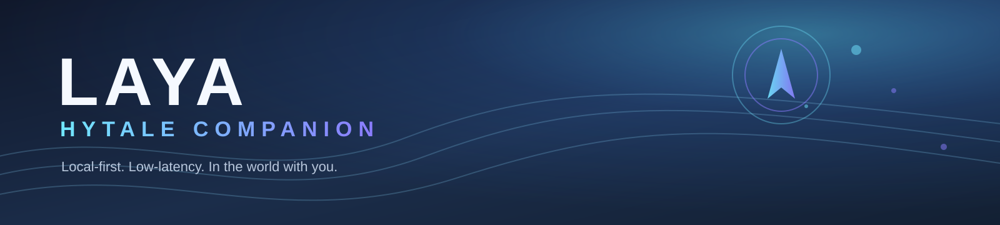

<p align="center">
  
</p>

<h1 align="center">LayaHytaleCompanion</h1>

<p align="center">
  A local-first AI companion for Hytale: she follows, talks, remembers, mines,
  gathers, and fights beside you.
</p>

<p align="center">
  <code>Hytale 0.7.x</code> &nbsp;|&nbsp; <code>Windows</code> &nbsp;|&nbsp;
  <code>Python 3.11</code> &nbsp;|&nbsp; <code>laya.cpp required</code>
</p>

## Why is she called Laya?

Laya is named after **[laya.cpp](https://github.com/lkarlslund/laya.cpp)**, the
open-source local inference engine that runs her decision model. The first
version of this companion was built around the idea of putting a real local
model inside Hytale and letting it run on the player's own GPU through Vulkan.

The engine is not an optional add-on. Laya uses the resident `laya.cpp` Vulkan
server for every decision, and the bridge refuses to start without the engine
and its `typed-decisions` checkpoint. The name is the architecture: **a local
brain for a world that usually only has scripted NPCs.**

## Why does she respond so fast?

Laya is designed to feel present, not like a chat window with a three-second
pause. The speed comes from the architecture, not a single trick:

- **The decision engine is resident.** `laya.cpp` starts once and stays warm on
  its own port. A turn does not load a model or restart a process.
- **Speech runs on ONNX.** Kokoro TTS and Parakeet STT use ONNX Runtime instead
  of a per-turn PyTorch warm-up. The models are warmed in the background at
  startup.
- **Cloud replies stream.** Groq can stream the reply while the first sentence
  is already being turned into speech, so the player hears Laya before the full
  answer has finished generating.
- **The reflex layer is deterministic.** Short commands such as "stay", "follow
  me", and "stop" never wait for an LLM round-trip. The plugin applies the
  action immediately.
- **The game state is local.** The plugin sends a live snapshot of Laya's held
  item, armor, appearance, and player state over the local bridge. There is no
  remote game server in the conversation path.
- **Localhost only.** The plugin bridge uses `127.0.0.1:8787`; the AI bridge
  uses `127.0.0.1:8788`. No network hop is added beyond the model provider.

On the development machine, typical turns are roughly **0.4-0.8 s for the LLM**
and the first spoken sentence arrives around **1-2 s** after the player sends a
message. Exact numbers depend on the provider, GPU, and whether vision is used.

## What she can do

- Follow you, hold position, defend, attack, and use the custom HUD.
- Talk with a natural voice and a lip/mouth animation that follows speech.
- Remember useful facts and recent conversation.
- Mine and gather with a deterministic task layer and block-name knowledge.
- Use a custom inventory page with Laya's pack, gear slots, player inventory,
  stacking, sorting, and click/double-click/right-click transfers.
- Look at the player's screen when asked to, when screen vision is configured.
- Start fresh for each new player: no bundled keys, inventory, memory, or skin.

## Install

### Requirements

- Windows 10/11
- Hytale 0.7.x
- Python 3.11
- A Windows Vulkan build of `laya.cpp` plus the `typed-decisions` checkpoint
- Java 25 only if you build the plugin yourself
- An API key from Groq, Google AI Studio, or z.ai for cloud replies
- About 1 GB free for the local speech models

### Quick start

1. Clone or download this repository.

   ```powershell
   git clone https://github.com/jonferno/LayaHytaleCompanion.git
   cd LayaHytaleCompanion
   ```

2. Install the required `laya.cpp` engine:

   1. Download a Windows Vulkan build and the `typed-decisions` checkpoint from
      <https://github.com/lkarlslund/laya.cpp/releases>.
   2. Put the `.exe` and `typed-decisions/` folder under `ai-bridge\laya\`.
   3. The installer and bridge both refuse to continue without them.

3. Double-click `install.bat`, or run:

   ```powershell
   powershell -ExecutionPolicy Bypass -File .\install.ps1
   ```

   The installer asks for your Hytale folder (usually `D:\Games\Hytale`),
   copies the plugin JAR, creates a local config with **empty keys**, installs
   the Python dependencies, and downloads the speech models unless you pass
   `-SkipModels`.

4. Run `start.bat`, open <http://127.0.0.1:8788>, and paste your API key into
   the settings page. Save the settings.
5. Start Hytale. The installer sets the plugin's config paths as user
   environment variables, so restart Hytale once after the first install.
6. In game, talk to Laya in chat or use `/laya`.

See [INSTALL.md](INSTALL.md) for manual setup, the required `laya.cpp` engine,
troubleshooting, and `reset-data.ps1` for a clean inventory, memory, and
appearance.

## How it works

```text
Hytale client
    |
    |  Java plugin (hytale-plugin/)
    |  - custom HUD and inventory page
    |  - NPC movement, tasks, combat, gear
    |  - localhost HTTP bridge :8787
    v
Python AI bridge (ai-bridge/)
    - memory and prompt construction
    - Groq / Google / z.ai LLM clients
    - Kokoro ONNX TTS + Parakeet ONNX STT
    - resident laya.cpp decision server :8090
    v
Hytale world state, speech, actions
```

- `hytale-plugin/` - Java plugin, UI, NPC controller, inventory, combat.
- `ai-bridge/` - Python sidecar: speech, LLM, memory, vision, decisions.
- `config/blocks.json` - player words to Hytale block names.
- `config/hytale-knowledge.json` - compact game-knowledge reference.
- `config/laya-persona.txt` - Laya's persona and response contract.
- `dist/LayaPlugin-0.2.0.jar` - convenience plugin build.

## Build the plugin

The repository ships `dist/LayaPlugin-0.2.0.jar`. It is built against the 0.7.x
server API and was rebuilt for Hytale 0.7.3. If Hytale changes its API again,
rebuild from source:

```powershell
$env:HYTALE_SERVER_JAR = "D:\Games\Hytale\install\release\package\game\latest\Server\HytaleServer.jar"
cd hytale-plugin
gradle build
```

The Gradle build uses `HYTALE_SERVER_JAR` and optionally `HYTALE_MODS_DIR`; it
does not contain machine-specific paths.

## Privacy and safety

- No API keys, personal skins, inventories, combat state, or chat memory are
  committed.
- `config/bridge-config.json`, `config/laya-*.json`, `logs/`, `models/`, and
  `ai-bridge/laya/` are git-ignored.
- The bridge listens on localhost only by default.
- API keys are only sent to the provider you configure.
- This repository starts with a fresh history. Do not merge private development
  branches that contain old config or keys.

## Credits

Plugin and bridge code by [Jonferno](https://github.com/jonferno). Built with
Hytale's plugin API, [laya.cpp](https://github.com/lkarlslund/laya.cpp),
FastAPI, Kokoro, Parakeet, and the Hytale modding community. See each upstream
project for its license.

### 100% vibe coded

This project was **100% vibe coded** with
[DeepSeek V4.1](https://www.deepseek.com/) and
[OpenCode](https://opencode.ai/). Huge thanks to both - they made building
Laya an absolute joy.
